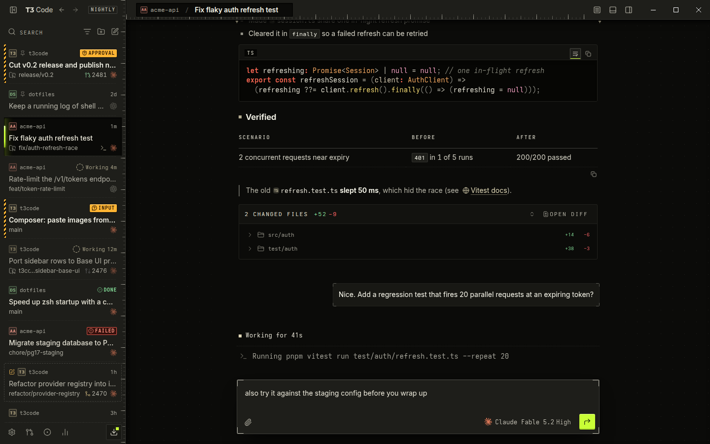
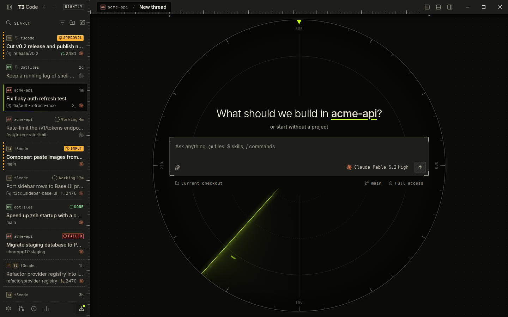
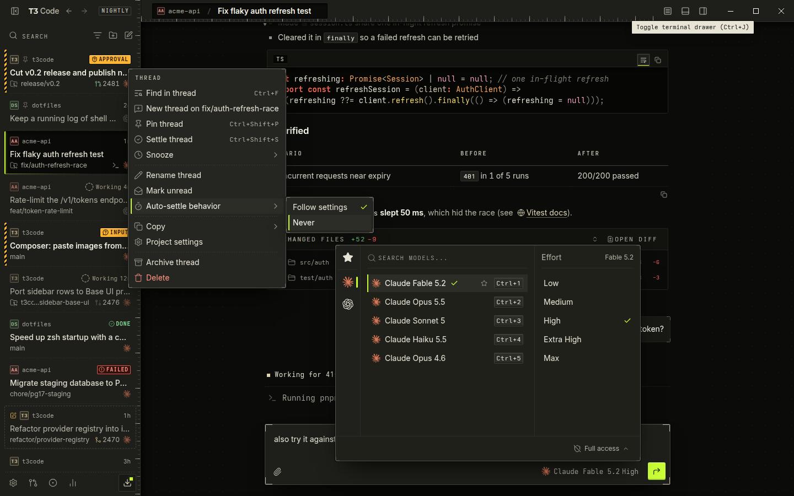
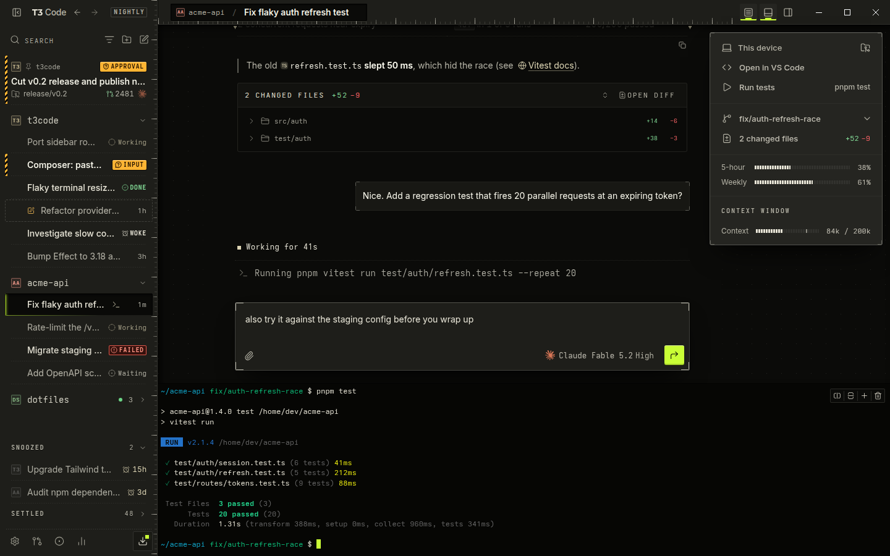
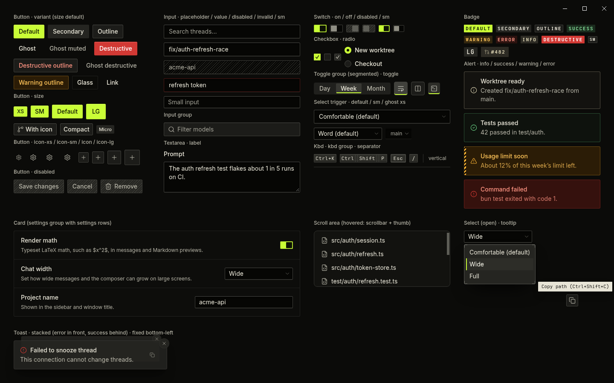
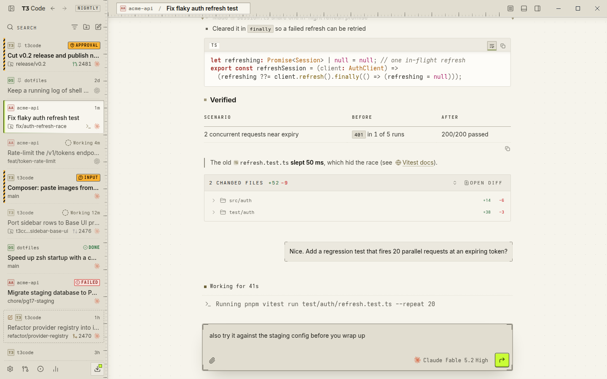
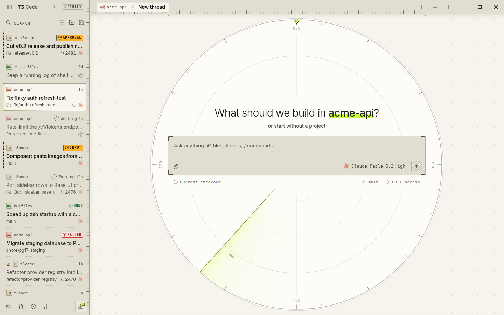
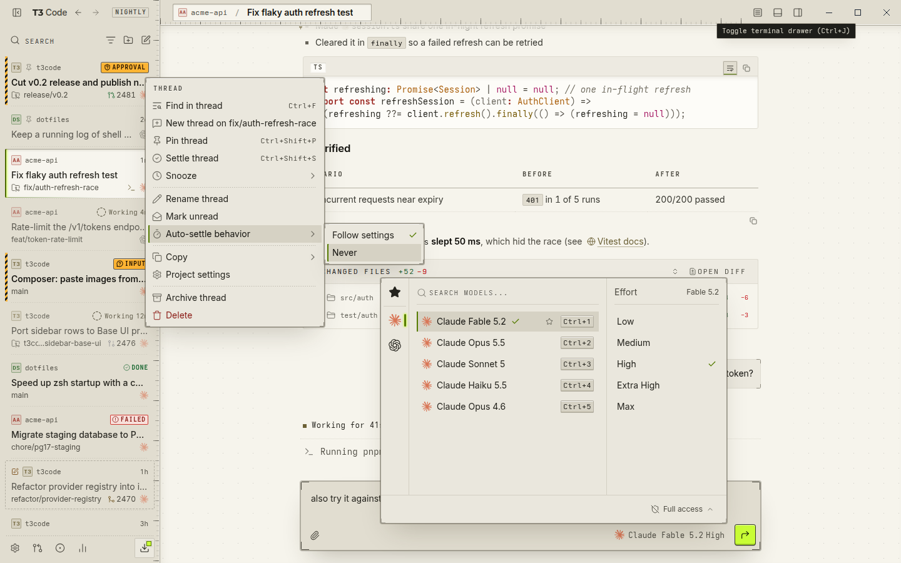
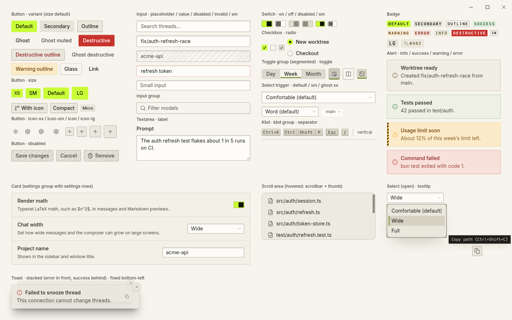

# ACID-01 · Carbon Instrument

A theme for [T3 Code](https://github.com/pingdotgg/t3code) that turns the app into a piece of precision test
equipment: a black carbon faceplate around a recessed display, one electric chartreuse signal lamp, and an amber
lamp for "an agent is waiting for you". It also has a light appearance, Daylight: the same instrument in bone
putty and paper.



| New thread | Menus and model picker |
| --- | --- |
|  |  |

| Terminal and thread details | Controls |
| --- | --- |
|  |  |

**Daylight**

| Open thread | New thread |
| --- | --- |
|  |  |

| Menus and model picker | Controls |
| --- | --- |
|  |  |

The screenshots are renders of a static replica of T3 Code's interface (its real stylesheet and DOM structure, with
sample content), not captures of the live app.

## What it changes

- **Two materials.** The sidebar, header, composer, menus and dialogs are the faceplate. The conversation, code
  blocks, terminal and input fields are a screen set into it: near-black at night, paper by day. Nothing bright
  floats on the screen.
- **Two lamps, one job each.** Chartreuse means yours, act, on: the open thread, the send key, focus, pressed
  toggles, checked items. Amber with hazard tape means a thread needs you (approval or input). A failed thread gets
  a red fault lamp. Running threads stay quiet.
- **Readouts.** The header breadcrumb is a small display window, and the open thread is the matching well in the
  sidebar.
- **Code.** The syntax palette is spread across warm hues and lightness steps, with keywords in bold, so each token
  class stands apart. Nothing in the theme is blue, violet or cyan.
- **Instrument details.** Ruler scales along the panel edges, registration brackets on the composer that light up
  on focus, engraved mono legends, label-tape tooltips, square switches, hatched disabled controls, keys that travel
  one pixel when pressed, and a radar-style scope around the composer on the new-thread screen.
- **Daylight.** In the light appearance lime stays a lit fill with black ink on it (send key, switches, primary
  buttons). Thin signal marks such as the focus ring and the open thread's bar use a deep acid green, because
  lime lines vanish on paper.
- **Calm by default.** No idle animation, no blur. The only motion is tied to state and switches off with T3 Code's
  panel-animation setting or the system's reduced-motion preference.

In the eight views it was checked against, in both appearances, no text falls below WCAG AA contrast; the stock
theme fails 13 text runs in the chat view alone.

## Install

There are two files. Both were built against T3 Code 0.1.11-nightly (November 2026) on desktop and web. Mobile
does not use themes with custom CSS.

| File | What you get |
| --- | --- |
| `acid-01.json` | Carbon (dark), with Daylight as its light variant. It follows T3 Code's light/dark setting. |
| `acid-01-light.json` | Daylight on its own, as a separate light theme. |

**On one device.** Open **Settings → Appearance**, choose **Add theme**, then import the file or paste its
contents.

**For every client of a server.** Save the file as `~/.t3/userdata/themes/acid-01.json` on the machine that runs
the T3 Code server (or the `themes` folder of your custom state directory), then run:

```bash
t3 theme set acid-01
```

The file name is the theme's ID (`acid-01-light.json` becomes `acid-01-light`). To go back, pick another theme in
Settings → Appearance, or run `t3 theme set t3-chat`.

## Gallery edition

The community gallery at [t3themes.com](https://t3themes.com) limits theme CSS to 20,000 characters, so
[`gallery/`](gallery/) holds a dark-only core edition written to fit. If you install by hand, use the files above.

## Change it

```
src/theme.meta.json   names, and all 61 color roles for each appearance
src/theme.css         the stylesheet, commented; every color is a token at the top, once per appearance
build.mjs             packs both into acid-01.json and acid-01-light.json (no dependencies)
tools/gen-scope.mjs   draws the new-thread scope into src/theme.css; takes a level from loud to c
```

```bash
node build.mjs
```

The new-thread scope ships at level `b`, the plain one. `node tools/gen-scope.mjs a && node build.mjs` turns it
up a step (more ticks, legends, a longer afterglow); `c` leaves only hairline rings and the sweep line.

One stylesheet serves both appearances: the rules are shared and only the tokens differ. The build strips
comments and whitespace, refuses a light variant that misses a color role, and refuses CSS that T3 Code would
reject (anything that loads a file, or a value containing a backslash). T3 Code allows 100,000 characters of
theme CSS; this theme uses about 59,000.

## Limits you should know about

- The terminal draws its text on a canvas with a fixed color table, so a few terminal colors (a blue badge, a cyan
  prompt) stay as the app ships them. Thread right-click menus on Linux are native menus and cannot be styled.
- Code colors are remapped by matching the highlighter's stock colors. If a T3 Code update changes those, some
  tokens will fall back to the stock palette until the map in `src/theme.css` is updated.
- T3 Code documents a short list of stable selectors. This theme also uses about a dozen undocumented `data-slot`
  values and a few icon class names for its status lamps. If one stops matching, the color roles still carry the
  meaning (an approval becomes amber text without its lamp), but check the sidebar after an app update. In the
  light appearance a few marks (check icons and "Default" tags in settings) are recolored through the app's
  utility class names; if those change, the marks fall back to lime and nothing else breaks.
- The open thread's bar and floor line are checked at display scales from 50% to 300%. Other one-pixel details
  (corner marks on menus, ruler ticks) can sit one device pixel off at fractional scales such as 125%.
- The theme was developed against a replica of the app, then corrected from reports in the live app. The light
  appearance has only been checked in the replica so far. If something looks wrong, please open an issue with a
  screenshot.

## How it was made

ACID-01 was designed by AI agents (Claude) over three rounds: five designers each built a different direction,
blind judges scored them, and the direction the repository owner picked was refined twice more against the judges'
critiques. The light appearance was added afterwards by another agent, with the dark renders held pixel-identical.
Every round was rendered and audited in a harness built from T3 Code's own stylesheet and palette code.

## License

[MIT](LICENSE). T3 Code is a product of T3 Tools; this theme is an independent project and is not affiliated with it.
