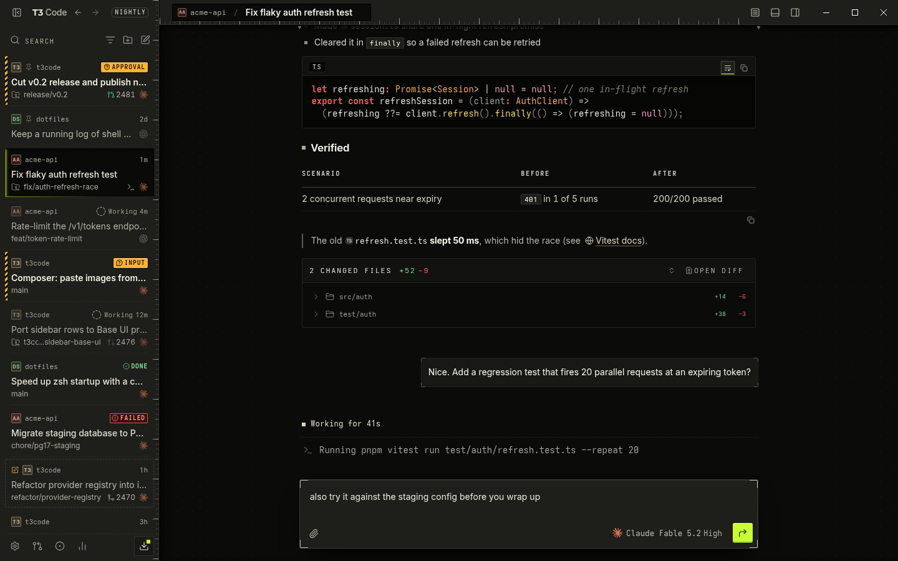

# ACID-01, gallery edition

[t3themes.com](https://t3themes.com) accepts at most 20,000 characters of theme CSS. The full dark theme uses about
43,000, so this folder holds a core edition written to fit: 19,480 characters, dark only.



It is the same theme to look at, with one exception: the new-thread screen keeps the calibration dial that the
full theme had up to 1.1.0, where the full theme now shows a plain field of dots. On every other
screen the core edition matches the full theme's render on more than 99% of pixels. What else it leaves out is
small: legends have no engraved shadow, some already-warm syntax colors keep the highlighter's own
values, badges are a size smaller, and there are no transitions.

```
src/theme.meta.json   name, author, description and the 61 color roles
src/theme.css         the stylesheet (uses CSS nesting; palette tokens are inlined at build time)
build.mjs             packs both into acid-01.json in the gallery's format (no dependencies)
```

```bash
node build.mjs
```

If you are installing by hand, use the full `acid-01.json` in the repository root instead.
